# Infinite-Canvas 系统解耦架构说明书 (architecture.md)

> **版本**：v2026.10.01  
> **维护团队**：[有物建筑 (MeansGroup)](https://means.group) · **开源原作者**：DX（wuli大雄）  
> **开源许可**：Apache License 2.0  
> **适用对象**：核心开发团队、AI 协作智能体 (Agents) 及二次开发者。  
> **核心原则**：第一性原理思考、奥卡姆剃刀、模块高内聚低耦合、极简外科手术式修改。

---

## 一、系统架构概览

MeansCanvas（原 Infinite-Canvas）采用前后端完全解耦、轻量化与高内聚的模块化架构：
- **前端**：无构建依赖的现代原生 Web 架构（ES2022 + TailwindCSS + Lucide Icons），核心分为主画布（`static/index.html` + `static/js/studio-shell.js` + `static/js/canvas.js`）与节点画布（`static/smart-canvas.html` + `static/js/smart-canvas.js`），支持纯画布（Pure Canvas）离线与免外部依赖秒级启动；
- **后端**：基于 FastAPI (ASGI) 的领域驱动拆分架构，按业务实体划分为 11 个独立领域路由，由 7 个核心基础支撑模块提供并发安全、缓存与网络防护。

```mermaid
flowchart TD
    subgraph ClientLayer ["前端视界层 (Frontend UI)"]
        WebCanvas["无限主画布 (index.html / canvas.js / studio-shell.js)"]
        SmartCanvas["智能节点图 (smart-canvas.html / smart-canvas.js)"]
        MobileCanvas["移动端改图页 (mobile.html / mobile.js)"]
        ExtTools["生态面板 (API 设置 / 素材管理 / ComfyUI 配置)"]
    end

    subgraph GatewayLayer ["网关与中间件层 (Gateway & Middlewares)"]
        ASGI["ASGI (FastAPI / Uvicorn 默认端口 3333)"]
        AuthMid["访问控制中间件 (IC_ACCESS_TOKEN 鉴权)"]
        GZip["GZip 动态压缩与安全响应头"]
        CORS["CORS 回环与内网网段白名单"]
    end

    subgraph RouterLayer ["领域业务路由层 (11 Domain Routers)"]
        R_Canvas["routers/canvas.py (画布 CRUD / 乐观锁 / 撤销)"]
        R_Assets["routers/assets.py (素材库 / 存储路径约束)"]
        R_Prompts["routers/prompts.py (提示词库 / 分类)"]
        R_Providers["routers/providers.py (AI 平台注册 / 主机绑定校验)"]
        R_Tasks["routers/tasks.py (异步任务看板 / 线程池卸载)"]
        R_System["routers/system.py (版本自检 / 安全下载 / 备份)"]
        R_ComfyUI["routers/comfyui.py (ComfyUI 本地桥接 / 离线 503 契约)"]
        R_Chat["routers/chat.py (多轮流式对话 / 会话管理 / Agent 决策)"]
        R_OnlineImg["routers/online_image.py (云端生图分发 / 格式转换)"]
        R_Video["routers/video.py (视频生成 / MiniMax 时间轴导出)"]
        R_Integrations["routers/integrations.py (RunningHub / 即梦 / CLI / 火山方舟)"]
    end

    subgraph CoreLayer ["核心基础支撑层 (7 Core Modules)"]
        C_Security["core/security.py (SSRF 校验 / DNS Pinning / 逐跳检测)"]
        C_History["core/history_manager.py (双端环形缓冲 deque / 深度递归 Base64 清洗)"]
        C_Cache["core/canvas_cache.py (st_mtime_ns 纳秒级文件缓存)"]
        C_Providers["core/providers.py (Provider 单一源 / Key 掩码 / 原子写盘)"]
        C_Media["core/media.py (媒体格式探测 / 安全输出转换)"]
        C_WS["core/ws_manager.py (SafeConnectionManager 安全广播)"]
        C_Pydantic["core/pydantic_compat.py (Pydantic V1/V2 跨版本适配)"]
    end

    subgraph EngineLayer ["执行引擎与外部驱动 (Engines)"]
        ComfyLocal["本地 ComfyUI 实例 (127.0.0.1:8188)"]
        CloudAPIs["云端 API (ModelScope, OpenAI 兼容, Pollinations, Agnes, 火山)"]
        LocalCLIs["本地 CLI 工具 (Antigravity agy, 即梦 CLI, Codex CLI)"]
        ComputeFarms["算力云应用 (RunningHub WebApps & Workflows)"]
    end

    ClientLayer --> GatewayLayer
    GatewayLayer --> RouterLayer
    RouterLayer --> CoreLayer
    RouterLayer --> EngineLayer
```

---

## 二、领域业务路由层 (11 Domain Routers)

所有领域路由文件均注册于 `routers/`，在 `main.py` 中显式挂载：

| 路由文件 | 核心职责 | 典型接口 |
| :--- | :--- | :--- |
| `routers/canvas.py` | 画布元数据增删改查、乐观并发控制（409 Conflict）、视口与缩略图 | `/api/canvases`, `/api/canvases/{id}` |
| `routers/assets.py` | 素材管理、存储目录约束、公共素材库路由 | `/api/assets/library`, `/api/upload` |
| `routers/prompts.py` | 提示词模板库检索、内置词库与批量管理 | `/api/prompts/libraries` |
| `routers/providers.py` | API 平台配置、连通性探测、API Key 目标主机防外泄绑定 | `/api/providers`, `/api/test-connection` |
| `routers/tasks.py` | 全局异步任务看板、历史持久化，线程池非阻塞执行 | `/api/tasks`, `/api/task-history` |
| `routers/system.py` | 应用版本自检、安全受控输出下载、目录穿越防护视图 | `/api/system/version`, `/api/download-output` |
| `routers/comfyui.py` | 本地 ComfyUI 桥接调度、历史轮询、服务离线标准 HTTP 503 协议 | `/api/generate`, `/api/canvas-comfy-tasks` |
| `routers/chat.py` | 多轮对话会话 CRUD、SSE 逐字流式推理、Agent 工具分发 | `/api/chat`, `/api/conversations` |
| `routers/online_image.py` | 云端生图任务管理、免 Key/付费通道适配、本地存储路径白名单 | `/api/canvas-image-tasks`, `/api/online-image` |
| `routers/video.py` | 云端 AI 视频生成分发、首尾帧控制、MiniMax 时间轴导出 | `/api/canvas-video-tasks`, `/api/smart-canvas/minimax-export` |
| `routers/integrations.py` | 外部生态运行时桥接：RunningHub 算力应用、即梦 CLI、Antigravity CLI、火山方舟 | `/api/runninghub/*`, `/api/gemini-cli/*` |

---

## 三、核心基础支撑层 (Core Modules)

| 支撑模块 | 核心机制与安全边界 |
| :--- | :--- |
| `core/security.py` | **SSRF 防御中心**：包含 IP 网段白名单校验、逐跳重定向检测、DNS 固定（DNS Pinning）与 `safe_download_bytes`。杜绝访问链路本地与保留网段。 |
| `core/history_manager.py` | **历史变动缓冲区**：采用 `collections.deque` 环形缓冲 + 深度递归 Base64 清洗 + 原子文件替换（`os.replace`）+ 全局锁 `GLOBAL_CONFIG_LOCK`。 |
| `core/canvas_cache.py` | **元数据缓存**：基于文件 `st_mtime_ns` 纳秒精度时间戳进行内存缓存，消除频繁大 JSON 读取的磁盘 I/O 阻塞。 |
| `core/providers.py` | **配置管理与密钥安全**：集中解析 `API/.env`；严格遵循掩码识别防守（`key_looks_masked`）与 `\r\n\0` 换行注入拦截。 |
| `core/media.py` | **媒体流规范化**：提供图片/视频引用类型判定与安全格式转换。 |
| `core/ws_manager.py` | **WebSocket 连接管理**：`SafeConnectionManager` 维护客户端连接生命周期与异常自愈清理。 |
| `core/pydantic_compat.py` | **框架兼容层**：抹平 Pydantic V1 与 V2 模型方法差异。 |

---

## 四、安全与架构契约底线

1. **凭证隔离与日志脱敏**：
   - 严禁将 `API/.env` 纳入版本控制；
   - 严禁在前后端通信、持久化日志与控制台中明文输出真实密钥；
   - 外部调用目标与保存的 Provider Base URL 严格比对权威主机（Host Binding），防止凭据外泄。
2. **所有出站网络调用强制 SSRF 检验**：
   - 凡接收外部 URL 参数进行拉取的端点，一律经过 `safe_download_bytes(allow_private=False)` 校验；
   - 重定向过程实施逐跳安全检查并限制最大跳数（≤5）。
3. **架构单向依赖与禁止循环**：
   - 领域路由严禁反向 `from main import ...`，跨模块通信统一经由 `routers/common.py` 的 getter/setter 或事件系统解耦。
